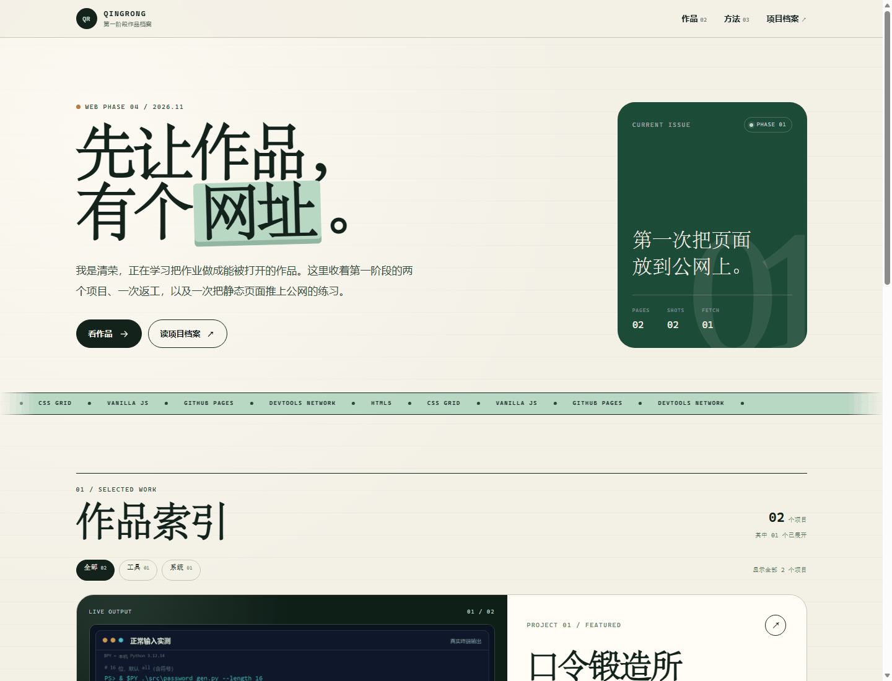
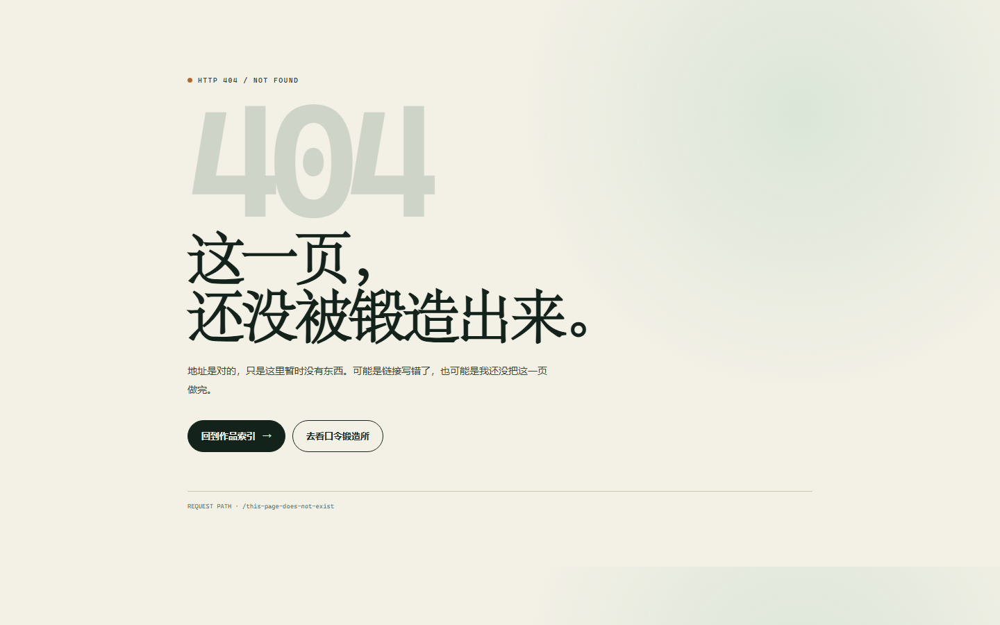
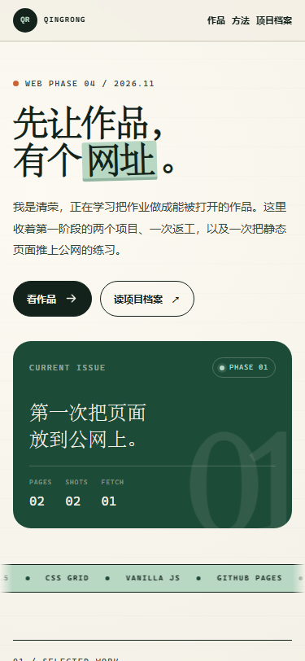
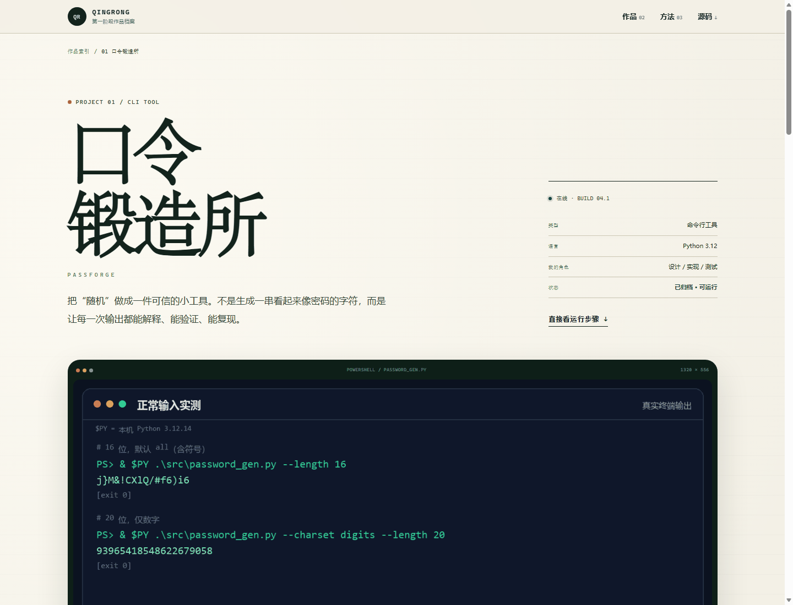
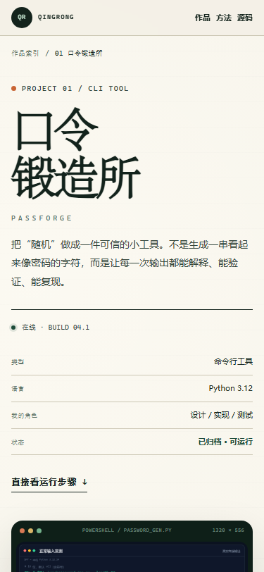

# web-phase4-yingqingshui1

第一阶段作品档案：一个不用框架、没有构建步骤的双页面静态站。

- **选题**：2 / 第一阶段项目展示页
- **线上地址**：<https://yingqingshui1.github.io/web-phase4-yingqingshui1/>
- **仓库**：<https://github.com/yingqingshui1/web-phase4-yingqingshui1>
- **部署**：GitHub Pages · `main` / root
- **本地入口**：`index.html`
- **详情页**：`project.html`（口令锻造所）
- **404**：`404.html`



## 这个站有什么

首页是作品索引，详情页是「口令锻造所」的项目档案。两页可以互相跳转：

- `index.html`：项目列表、筛选器、项目简卡、方法说明
- `project.html`：项目简介、功能截图、运行步骤、源码下载、构建状态
- `404.html`：故意请求不存在路径时返回的自定义 404

页面里的图片都来自真实运行记录：

| 文件 | 尺寸 | 大小 | 用途 |
|---|---:|---:|---|
| `assets/terminal-normal.png` | 1320 × 556 | 42 KB | 正常输入终端截图 |
| `assets/terminal-edge.png` | 1320 × 1150 | 113 KB | 边界输入终端截图 |

两张图都低于 300 KB。页面没有外部字体、图片 CDN 或第三方脚本。

## 本地打开

不要直接双击 `index.html`：`fetch('data/status.json')` 在 `file://` 下会被浏览器拦截。用任意静态服务器打开即可。

### 方式 A：项目自带的小服务器（推荐）

需要 Python 3.10+：

```powershell
cd web-phase4-yingqingshui1
python serve.py
```

打开 <http://127.0.0.1:4173/>。`serve.py` 会让不存在的路径返回真正的 `404.html` 和 HTTP 404 状态，和线上行为一致。

### 方式 B：Python 标准库

```powershell
cd web-phase4-yingqingshui1
python -m http.server 4173
```

打开 <http://127.0.0.1:4173/>。这个方式也能看页面，但 404 会显示 Python 的默认错误页。

## 验收对照

| 要求 | 实现 |
|---|---|
| 至少 2 个页面，能互相跳转 | `index.html` ↔ `project.html`；首页有「打开项目档案」，详情页有「回到作品索引」 |
| 语义化标签 | `header`、`nav`、`main`、`section`、`article`、`aside`、`footer`、`figure`、`blockquote` |
| 375px 响应式 | `375 × 812` 下 `document.documentElement.scrollWidth === 375`，无横向滚动条 |
| 至少 1 处 JS 交互 | 首页项目筛选（`js/main.js`）；详情页复制命令 + `fetch` 构建状态（`js/project.js`） |
| 图片单张 < 300 KB | 页面图片 42 KB / 113 KB |
| 控制台无红色报错 | 正常页面 0 条 error；故意访问 404 时只有浏览器对 404 资源的那一条预期日志 |
| HTTPS 公网地址 | <https://yingqingshui1.github.io/web-phase4-yingqingshui1/>（GitHub Pages） |

本地验证结果（Edge 157，2026-11-11）：

- 1440px：`scrollWidth 1425`（垂直滚动条占 15px），`horizontalOverflow: false`
- 375px：`scrollWidth 375`，`horizontalOverflow: false`
- 筛选「系统」：只显示 1 张卡片，状态文案为「已筛选：系统 · 1 个项目」
- 复制按钮：剪贴板内容为 `python assets/password_gen.py --length 16`
- 正常页面控制台 error：0
- `/this-page-does-not-exist`：HTTP 404，显示自定义 404 页面

## 抓包记录

采集方式：Edge DevTools Network（通过 DevTools Protocol 同步记录请求、状态码与 `loadingFinished` 时间），本地服务器 `127.0.0.1:4173`。

| # | 请求 | 方法 | 状态码 | 耗时 |
|---|---|---|---:|---:|
| 1 | `/project.html`（页面主文档） | GET | 200 | 4 ms |
| 2 | `/css/style.css`（样式表） | GET | 200 | 5 ms |
| 3 | `/data/status.json`（自己写的 `fetch`） | GET | 200 | 7 ms |

补充：`/js/project.js` 为 10 ms、`/assets/terminal-normal.png` 为 6 ms；均为 200。完整记录见 `evidence/capture-report.json`。

### 故意请求不存在的路径

请求：`GET /this-page-does-not-exist`

响应：**404 Not Found**，返回自定义 404 页面。



控制台里会出现一条 404 资源日志，这是故意制造的；正常页面没有 error。

> 说明：上表是本地回环地址的耗时，只用于说明请求顺序与状态码；真实公网耗时会在部署后重新采样。

## 截图

电脑端首页 1440 × 1100：


手机端首页 375 × 812：



电脑端详情页：



手机端详情页：



完整长截图也在 `screenshots/` 下，文件名以 `-full.png` 结尾。

## 部署到 GitHub Pages

仓库建议名：`web-phase4-yingqingshui1`。

```powershell
cd web-phase4-yingqingshui1
git init
git add .
git commit -m "feat: phase 04 static portfolio"
git branch -M main
git remote add origin https://github.com/yingqingshui1/web-phase4-yingqingshui1.git
git push -u origin main
```

然后在 GitHub 仓库中：

1. Settings → Pages
2. Build and deployment → Source: **Deploy from a branch**
3. Branch: `main`，目录 `/ (root)`
4. Save，等待 Actions 完成
5. 线上地址：`https://yingqingshui1.github.io/web-phase4-yingqingshui1/`

`.nojekyll` 已放在根目录，避免 GitHub Pages 对静态文件做 Jekyll 处理。

### 备选：Vercel

```powershell
npm i -g vercel
vercel --prod
```

项目是纯静态文件，不需要 Build Command，Output Directory 留空或填 `.`。

### 备选：Cloudflare Pages

在 Cloudflare Dashboard → Workers & Pages → Create → Pages → Upload assets，把整个目录拖进去即可。或使用 Wrangler：

```powershell
npx wrangler pages deploy . --project-name web-phase4-yingqingshui1
```

## 目录

```text
web-phase4-yingqingshui1/
├─ index.html               # 列表 / 首页
├─ project.html             # 项目详情
├─ 404.html                 # 自定义 404
├─ css/style.css            # 全部样式与响应式
├─ js/main.js               # 项目筛选
├─ js/project.js            # 复制命令 + fetch 状态
├─ data/status.json         # 被 fetch 的静态数据
├─ assets/
│  ├─ terminal-normal.png
│  ├─ terminal-edge.png
│  ├─ password_gen.py       # 可下载源码
│  └─ favicon.svg
├─ screenshots/             # 电脑端与手机端截图
├─ evidence/                # 抓包与验证记录
├─ serve.py                 # 本地预览 + 自定义 404
├─ .nojekyll
└─ README.md
```

## 设计说明

页面用纸张色、墨绿和薄荷绿做底色，衬线中文做大标题，等宽字体做元数据。结构上先把「作品索引」和「项目档案」讲清楚，再用筛选和复制把交互收在必要的地方。

没有使用框架，也没有为了动效牺牲可读性。`prefers-reduced-motion: reduce` 下会关闭 ticker 动画和过渡。
