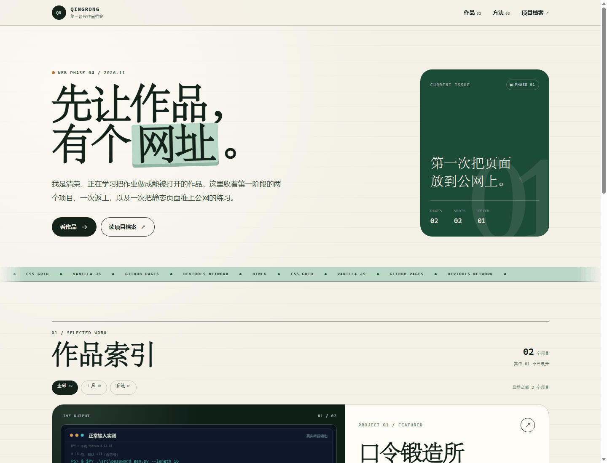
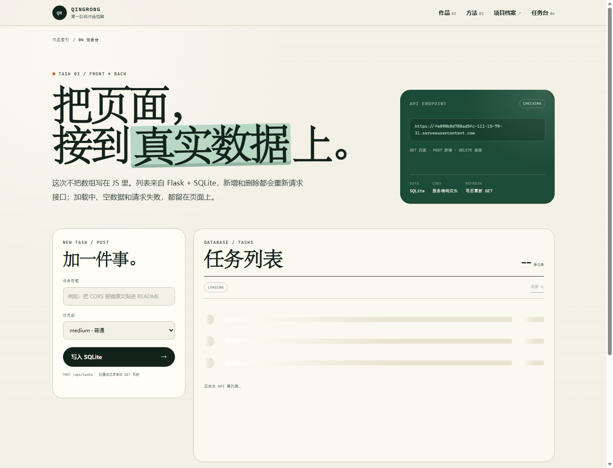
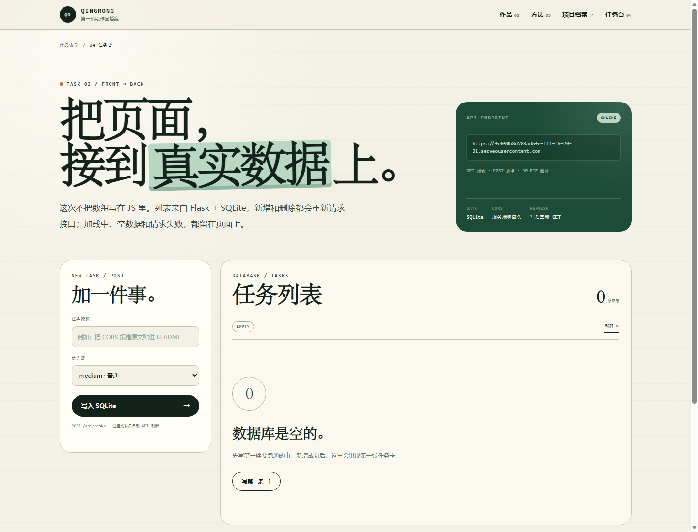
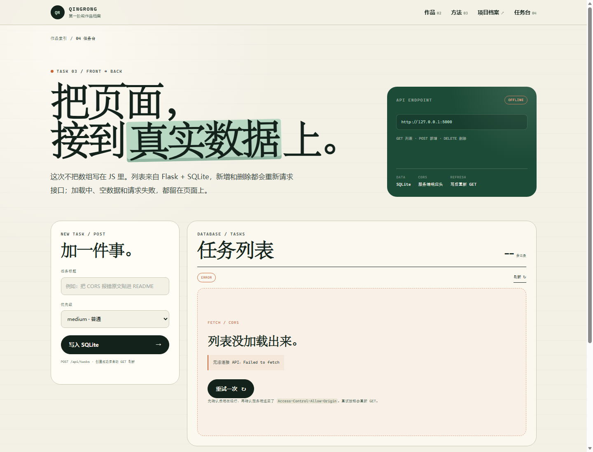
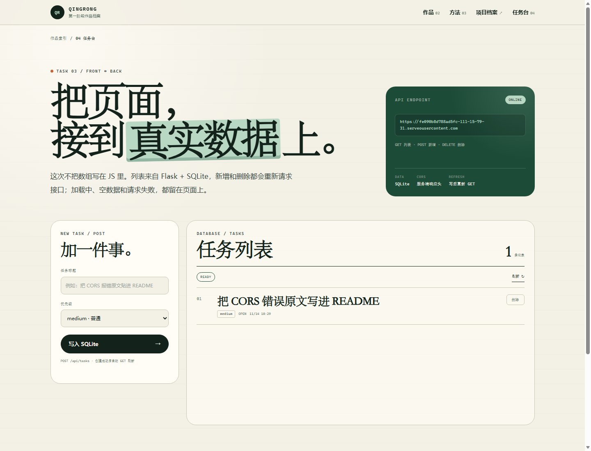
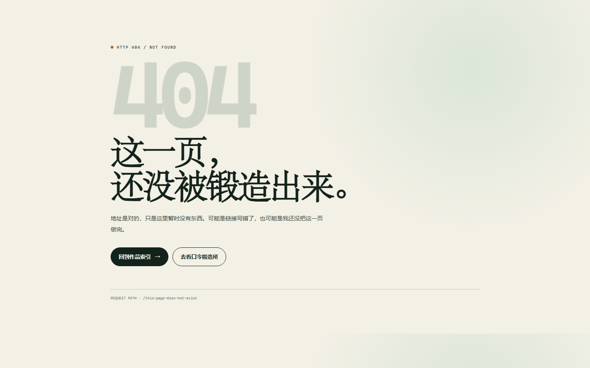
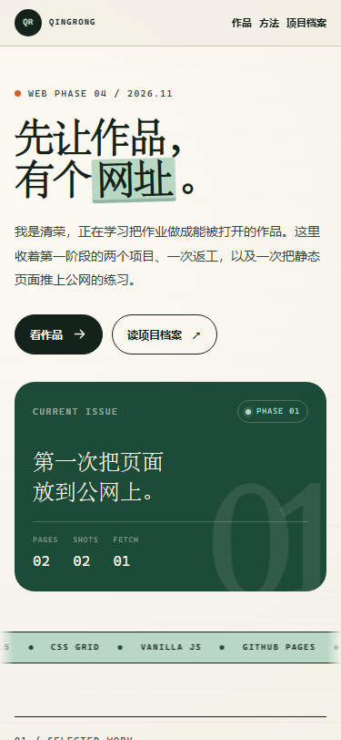
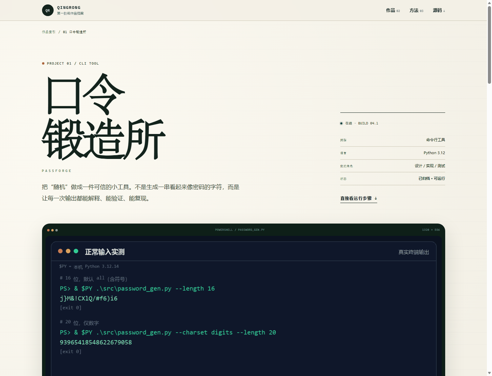
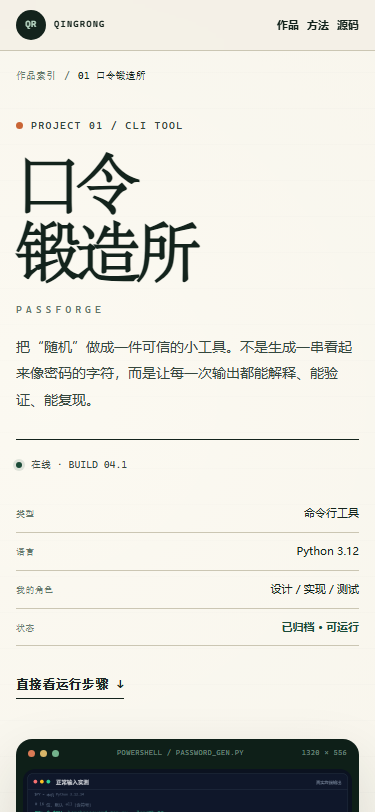
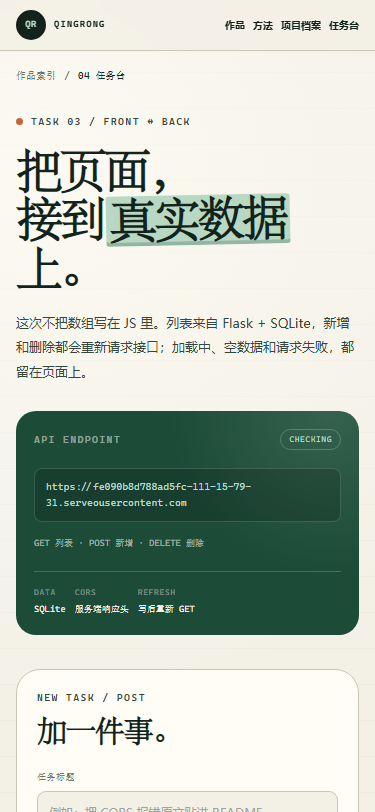

# web-phase4-yingqingshui1

第一阶段作品档案，加上一个真正连接 Flask + SQLite 的任务台。

- **任务 1 选题**：2 / 第一阶段项目展示页
- **线上站点**：<https://yingqingshui1.github.io/web-phase4-yingqingshui1/>
- **任务台**：<https://yingqingshui1.github.io/web-phase4-yingqingshui1/tasks.html>
- **前端仓库**：<https://github.com/yingqingshui1/web-phase4-yingqingshui1>
- **后端仓库**：<https://github.com/yingqingshui1/task2-api-yingqingshui1>
- **部署**：GitHub Pages · `main` / root
- **任务 3 后端**：`https://1f1740eee74e8f64-111-15-79-4.serveousercontent.com`（当前验收用的 HTTPS 隧道）
- **任务 3 前端配置**：`js/config.js` 的 `API_BASE_URL` / `LOCAL_API_BASE_URL`

> 后端隧道是临时演示，指向本机 Flask。隧道关闭后任务台会进入 error 状态并显示重试按钮；持久部署配置见任务 2 仓库的 [`render.yaml`](https://github.com/yingqingshui1/task2-api-yingqingshui1/blob/main/render.yaml)。



## 这个站有什么

- `index.html`：作品索引、项目筛选、方法说明
- `project.html`：口令锻造所的项目档案、截图、运行步骤、源码下载
- `tasks.html`：任务台，`fetch` 连接 Flask API，支持新增、删除、三态和重试
- `404.html`：故意请求不存在路径时的自定义 404

### 任务台：把页面接到真实数据

任务台不是把数组写死在 JS 里，而是每次渲染都请求 `GET /api/tasks`。新增和删除之后都会重新 GET 刷新列表；按 F5 后数据来自 SQLite。

三个状态都可以直接看到：

| 状态 | 触发条件 | 页面表现 |
|---|---|---|
| loading | 请求尚未返回 | 三条骨架屏 + `LOADING` + `正在向 API 要列表…` |
| empty | `data.total === 0` | `0 条记录` + 空状态说明 + `写第一条` |
| error | 断网 / 后端关闭 / CORS 拦截 | 错误原文 + `重试一次` + CORS 排查提示 |
| success | 有任务数据 | 任务卡列表、优先级、创建时间、两步删除 |









### 线上验收

- 页面：<https://yingqingshui1.github.io/web-phase4-yingqingshui1/tasks.html>
- 线上 API：`https://1f1740eee74e8f64-111-15-79-4.serveousercontent.com/api/tasks`
- 实测：Edge 打开线上页面，列表来自 API；新增「线上新增与删除都已验证」、两步删除旧任务、F5 后再次 GET，数据仍在；控制台 0 条 error。


### 配置项

业务代码不写死后端地址：

```js
// js/config.js
window.APP_CONFIG = {
  API_BASE_URL: "https://1f1740eee74e8f64-111-15-79-4.serveousercontent.com",
  LOCAL_API_BASE_URL: "http://127.0.0.1:5000"
};
```

`tasks.js` 根据当前 hostname 选择本地或线上地址。换后端只改这个文件，不动业务逻辑。

### CORS 事故记录

联调时先让后端以 `CORS_ORIGINS=none` 启动，真实撞到了一次跨域错误。浏览器原文：

```text
Access to fetch at 'http://127.0.0.1:5000/api/tasks' from origin 'http://127.0.0.1:4173' has been blocked by CORS policy: No 'Access-Control-Allow-Origin' header is present on the requested resource.
```

解决方式是在 Flask 的 `after_request` 里加跨域响应头，按 `CORS_ORIGINS` 白名单放行，不使用 `--disable-web-security`。完整过程见 [`docs/cors-incident.md`](docs/cors-incident.md)，原始记录见 [`evidence/cors-error.txt`](evidence/cors-error.txt) 和 [`evidence/cors-after.txt`](evidence/cors-after.txt)。


## 任务 1：主视觉页面

首页是作品索引，详情页是「口令锻造所」的项目档案。两页可以互相跳转：

- `index.html`：项目列表、筛选器、项目简卡、方法说明
- `project.html`：项目简介、功能截图、运行步骤、源码下载、构建状态
- `404.html`：故意请求不存在路径时返回的自定义 404

页面里的图片都来自真实运行记录：

| 文件 | 尺寸 | 大小 | 用途 |
|---|---:|---:|---|
| `assets/terminal-normal.png` | 1320 × 556 | 42 KB | 正常输入终端截图 |
| `assets/terminal-edge.png` | 1320 × 1150 | 113 KB | 边界输入终端截图 |

两张图都低于 300 KB；`screenshots/` 和 `evidence/` 里的交付截图也逐张压到 300 KB 以内。页面没有外部字体、图片 CDN 或第三方脚本。

## 本地打开

不要直接双击 `index.html`：`fetch('data/status.json')` 在 `file://` 下会被浏览器拦截。用任意静态服务器打开即可。

### 1. 启动任务 2 后端

```powershell
cd task2-api-yingqingshui1
$env:CORS_ORIGINS = "http://127.0.0.1:4173,https://yingqingshui1.github.io"
$env:PORT = "5000"
$env:TASKS_DB = "data/tasks3.db"
.\.venv\Scripts\python.exe app.py
```

### 2. 启动前端

```powershell
cd web-phase4-yingqingshui1
python serve.py
```

打开 <http://127.0.0.1:4173/>，任务台地址是 <http://127.0.0.1:4173/tasks.html>。

`serve.py` 会让不存在的路径返回真正的 `404.html` 和 HTTP 404 状态，和线上行为一致。

如果只想看静态首页，也可以用：

```powershell
python -m http.server 4173
```

### 3. 直接看接口

```powershell
curl.exe -sS http://127.0.0.1:5000/api/tasks
```

## 验收对照

| 要求 | 实现 |
|---|---|
| 前端 fetch 调自己的接口渲染列表，不写死数组 | `js/tasks.js` 只维护 `state.items`，每次 `loadTasks()` 请求 `GET /api/tasks` |
| loading / empty / error 三态 | 三个独立 `data-view` 分支；error 有 `重试一次` 按钮 |
| 新增或删除后自动刷新 | POST / DELETE 成功后重新 `GET /api/tasks` |
| F5 后数据仍在 | 后端 SQLite `data/tasks3.db`；移动端截图就是刷新后重新拉取的结果 |
| 后端地址抽成配置项 | `js/config.js` 的 `API_BASE_URL` / `LOCAL_API_BASE_URL` |
| CORS 在服务端解 | Flask `after_request` + `CORS_ORIGINS` 白名单，`OPTIONS` 预检返回方法/头 |
| 至少 2 个页面，互相跳转 | 首页、任务台、项目详情、404；导航和卡片互跳 |
| 语义化标签 | `header`、`nav`、`main`、`section`、`article`、`aside`、`footer`、`figure` |
| 375px 响应式 | 375 × 812 下无横向滚动；任务台移动端截图见 `evidence/task3-mobile-success.png` |
| 控制台无红色报错 | 正常首页/任务台 0 条 error；CORS 失败截图是故意制造的 error 态 |

验证结果（Edge 157，2026-11-14，本地 + 公网）：

- 1440px：`scrollWidth 1425`（垂直滚动条占 15px），`horizontalOverflow: false`
- 375px：`scrollWidth 375`，`horizontalOverflow: false`
- 任务台：先 loading → empty → 表单新增 → list → 两步删除 → empty；F5 后重新 GET 仍返回数据
- CORS：修复前 `net::ERR_FAILED`，修复后预检和实际 GET 都返回 `Access-Control-Allow-Origin`
- 正常页面控制台 error：0
- `/this-page-does-not-exist`：HTTP 404，显示自定义 404 页面

## 抓包记录（任务 1）

采集方式：Edge DevTools Network（通过 DevTools Protocol 同步记录请求、状态码与 `loadingFinished` 时间），公网地址 `https://yingqingshui1.github.io/web-phase4-yingqingshui1/project.html`，单次冷缓存样本。

| # | 请求 | 方法 | 状态码 | 耗时 |
|---|---|---|---:|---:|
| 1 | `/project.html`（页面主文档） | GET | 200 | 665 ms |
| 2 | `/css/style.css`（样式表） | GET | 200 | 936 ms |
| 3 | `/data/status.json`（自己写的 `fetch`） | GET | 200 | 678 ms |

其余请求同样是 200；完整请求列表、MIME 类型和耗时都在 `evidence/capture-report.json`。公网耗时受本机网络和 GitHub Pages CDN 影响，每次打开会有波动，这里只取一次实际记录，不当作性能承诺。

### 故意请求不存在的路径

请求：`GET /this-page-does-not-exist`

响应：**404 Not Found**，返回自定义 404 页面。



控制台里会出现一条 404 资源日志，这是故意制造的；正常页面没有 error。

## 截图

电脑端首页 1440 × 1100：


手机端首页 375 × 812：



电脑端详情页：



手机端详情页：



任务台手机端：



完整长截图也在 `screenshots/` 下，文件名以 `-full.png` 结尾。

## 部署

### 前端

GitHub Pages：`main` / root，`.nojekyll` 已放在根目录。

```powershell
cd web-phase4-yingqingshui1
git init
git add .
git commit -m "feat: phase 04 static portfolio"
git branch -M main
git remote add origin https://github.com/yingqingshui1/web-phase4-yingqingshui1.git
git push -u origin main
```

仓库 Settings → Pages → Deploy from a branch → `main` / `/ (root)`。

### 后端

任务 2 仓库提供 `Procfile` 和 `render.yaml`：

```text
web: gunicorn app:app --bind 0.0.0.0:$PORT
```

Render 环境变量：

```text
CORS_ORIGINS = https://yingqingshui1.github.io
```

当前验收地址是 HTTPS 隧道，不是永久实例；如果隧道断开，页面会正确进入 error 状态。需要长期在线时，按 `render.yaml` 部署并把 `js/config.js` 的 `API_BASE_URL` 换成 Render 地址。

## 目录

```text
web-phase4-yingqingshui1/
├─ index.html               # 作品索引 / 首页
├─ project.html             # 项目详情
├─ tasks.html               # 任务台（前端联调）
├─ 404.html                 # 自定义 404
├─ css/
│  ├─ style.css             # 全站基础样式
│  └─ tasks.css             # 任务台样式与三态
├─ js/
│  ├─ config.js             # 后端地址配置
│  ├─ tasks.js              # fetch、三态、增删刷新
│  ├─ main.js               # 项目筛选
│  └─ project.js            # 复制 + fetch 状态
├─ docs/cors-incident.md    # 真实 CORS 事故记录
├─ data/status.json         # 被 fetch 的静态数据
├─ assets/                  # 截图、源码、favicon
├─ screenshots/             # 首页 / 详情页截图
├─ evidence/                # 任务台三态、CORS、抓包记录
├─ serve.py                 # 本地预览 + 自定义 404
├─ .nojekyll
└─ README.md
```

## 设计说明

页面用纸张色、墨绿和薄荷绿做底色，衬线中文做大标题，等宽字体做元数据。任务台沿用同一套版式，把「写一条」和「看数据库」放在同一屏幕里，三态不是藏在控制台，而是直接留在页面上。

没有使用框架，也没有为了动效牺牲可读性。`prefers-reduced-motion: reduce` 下会关闭 ticker 动画和过渡。
