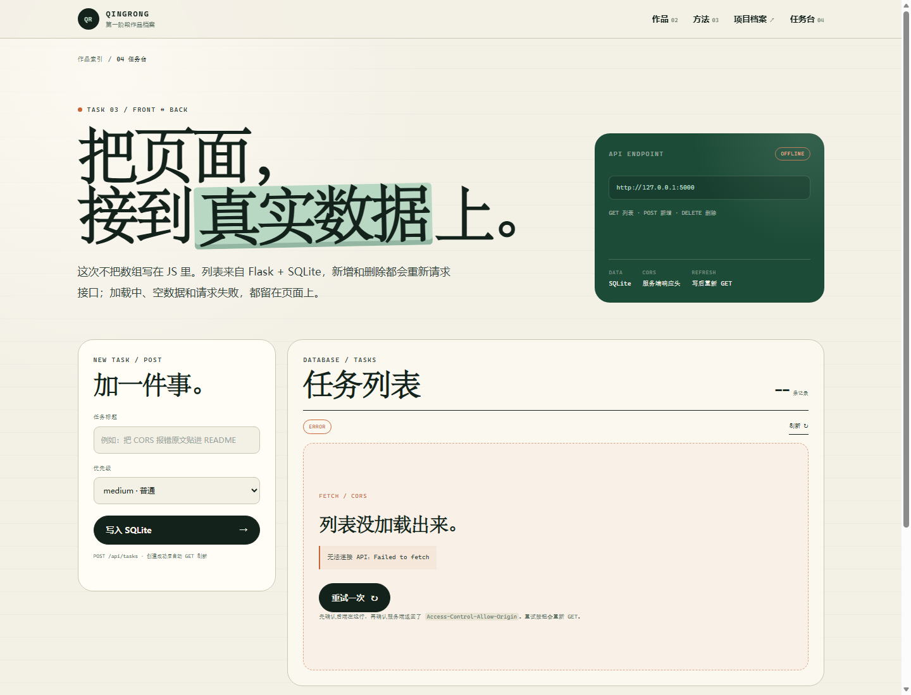
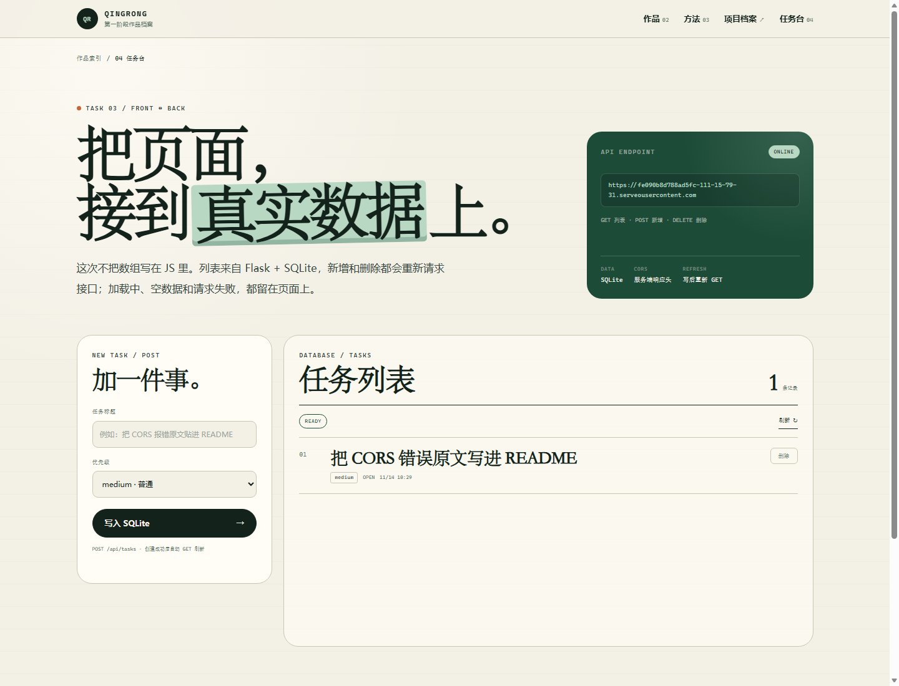

# 一次真实的 CORS 失败记录

## 现场

- 前端：`http://127.0.0.1:4173/tasks.html`
- 后端：`http://127.0.0.1:5000`
- 浏览器：Microsoft Edge 157
- 后端启动时故意关闭跨域头：

```powershell
cd task2-api-yingqingshui1
$env:CORS_ORIGINS = "none"
$env:PORT = "5000"
$env:TASKS_DB = "data/tasks3.db"
.\.venv\Scripts\python.exe app.py
```

前端确实发出了请求，页面也进入了 error 状态，但列表没有数据。

## 报错原文

浏览器 Console：

```text
Access to fetch at 'http://127.0.0.1:5000/api/tasks' from origin 'http://127.0.0.1:4173' has been blocked by CORS policy: No 'Access-Control-Allow-Origin' header is present on the requested resource.
Failed to load resource: net::ERR_FAILED
```

页面上的用户可见错误：

```text
无法连接 API：Failed to fetch
```

Network 面板里对应的请求：

```text
type: Fetch
errorText: net::ERR_FAILED
```

完整抓取记录见 [`evidence/cors-error.txt`](../evidence/cors-error.txt)，错误态截图见 [`evidence/task3-cors-error.png`](../evidence/task3-cors-error.png)。



## 排查过程

1. 直接用 curl 请求 API，返回 200，说明 Flask 本身是活的。
2. 加上浏览器请求的 `Origin` 再看响应头：

```powershell
curl.exe -i http://127.0.0.1:5000/api/tasks `
  -H "Origin: http://127.0.0.1:4173"
```

响应里没有 `Access-Control-Allow-Origin`。问题不在前端代码，也不在数据库。
3. 前端和后端端口不同，属于跨域；浏览器先拦截响应，前端只能拿到 `TypeError: Failed to fetch`。

## 解决

在 Flask 里加统一的 `after_request`：

```python
@app.after_request
def add_cors_headers(response):
    origins = app.config["CORS_ORIGINS"]
    origin = (request.headers.get("Origin") or "").rstrip("/")
    if not origins:
        return response

    if "*" in origins:
        response.headers["Access-Control-Allow-Origin"] = "*"
    elif origin and origin in origins:
        response.headers["Access-Control-Allow-Origin"] = origin
        response.headers.add("Vary", "Origin")
    else:
        return response

    response.headers["Access-Control-Allow-Methods"] = "GET, POST, PUT, DELETE, OPTIONS"
    response.headers["Access-Control-Allow-Headers"] = "Content-Type"
    response.headers["Access-Control-Max-Age"] = "86400"
    return response
```

允许来源由环境变量控制，不写死在业务代码里：

```powershell
$env:CORS_ORIGINS = "http://127.0.0.1:4173,https://yingqingshui1.github.io"
```

重启后，同一个 GET 请求的响应头变为：

```text
Access-Control-Allow-Origin: http://127.0.0.1:4173
Access-Control-Allow-Methods: GET, POST, PUT, DELETE, OPTIONS
Access-Control-Allow-Headers: Content-Type
Access-Control-Max-Age: 86400
```

完整响应头见 [`evidence/cors-after.txt`](../evidence/cors-after.txt)。

## 修复后的页面



## 为什么没有改浏览器

没有使用 `--disable-web-security`，也没有让前端走代理。跨域是服务端的响应策略问题，正确修法是在服务端声明允许的来源；浏览器安全策略保持原样。
